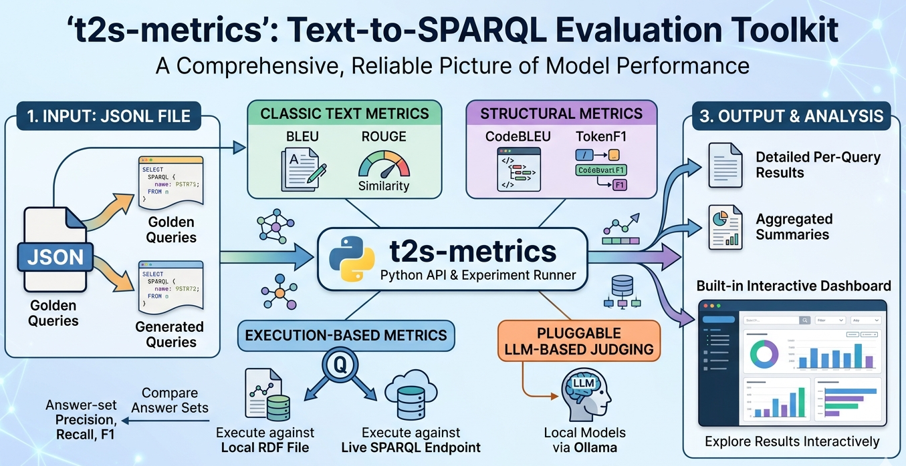
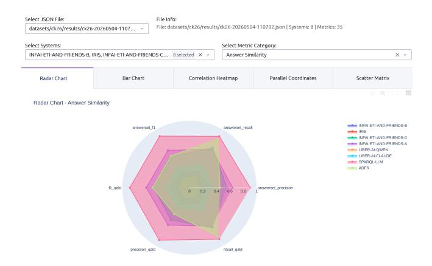

# Summary

Text-to-SPARQL systems translate natural-language questions into SPARQL queries over knowledge graphs. Their evaluation is difficult because query quality has several dimensions: a generated query can be lexically different from a reference while being logically equivalent, or it can return the expected answers for the wrong reason. Conversely, a query can be structurally plausible but syntactically invalid, contain hallucinated IRIs, or return only part of the expected answer set.

**t2s-metrics** is an open-source Python library for reproducible, multi-dimensional evaluation of Text-to-SPARQL and Knowledge Graph Question Answering (KGQA) systems. It reads evaluation cases from JSONL files, applies a configurable collection of metrics, optionally executes generated and reference queries against a knowledge graph, aggregates per-case results, and exports machine-readable reports. The package also provides a command-line interface, a Python API, a static dashboard, and rule-based filtering for diagnosing subsets of evaluation cases.

The library is available from [PyPI](https://pypi.org/project/t2s-metrics/), documented on [Read the Docs](https://t2s-metrics.readthedocs.io/en/latest/), and archived with DOI [10.5281/zenodo.19051440](https://doi.org/10.5281/zenodo.19051440). The source code and example datasets are hosted in the [GitHub repository](https://github.com/Wimmics/t2s-metrics). This [video](https://www.youtube.com/watch?v=ETmzMsnYEqY) provides a walk-through of the evaluation workflow, configuration options, and execution backends supported by the library.


# Statement of need

Evaluation practice for KGQA is fragmented. Studies often report one or two metrics, such as query exact match, BLEU, or answer-set F1, even though these metrics answer different questions [@elmke2026]. String-based metrics are cheap and reproducible, but penalize harmless changes in variable names, prefixes, and triple-pattern order. Execution metrics are closer to functional correctness, but require a stable knowledge graph or endpoint and can produce misleading matches when an incorrect query happens to return the same answers as the reference. Empty result sets and boolean queries are particularly important edge cases.

These limitations make it difficult to compare systems across studies and to diagnose why a generation succeeds or fails. They also make evaluation pipelines hard to reproduce: metric implementations, query normalization, endpoint configuration, and aggregation scripts are frequently distributed across separate projects. t2s-metrics addresses this gap by putting these operations behind one configurable interface. It is intended for researchers and developers who need to evaluate a single model, compare several systems, inspect failure cases, or run repeatable benchmark experiments.

# State of the field

Text-to-SPARQL evaluation lies between natural-language generation, program analysis, and information retrieval. Existing task repositories commonly implement a small set of task-specific metrics, while general information retrieval packages such as `pytrec_eval` and `ir-measures` provide mature ranking metrics [@pytrec_eval2018; @ir_measures2022]. These tools do not provide a SPARQL-aware case model, query parsing and normalization, graph execution backends, answer-set comparison, or URI-hallucination diagnostics.

t2s-metrics complements rather than replaces those tools. It includes common lexical metrics (BLEU, ROUGE, METEOR, token precision/recall/F1, cosine and edit-distance metrics), code-oriented comparison (CodeBLEU), and exact or structural query comparisons. It also includes execution-based metrics such as answer-set precision, recall, F1, QALD- and SPINACH-style comparisons, query execution validity, and URI hallucination. Ranking metrics include MRR, nDCG, precision@k, and hit@k. An optional LLM-as-a-judge metric can provide a qualitative score and explanation through a local Ollama backend. The library also supports canonicalization-based comparisons. SP-BLEU and related metrics reduce sensitivity to variable naming, while QCan-based metrics canonicalize queries before applying string-based metrics [@canonical_t2s2026].

# Software design

As illustrated in \autoref{fig:architecture} t2s-metrics uses a pipeline architecture:

1. JSONL readers create evaluation cases containing an identifier, a reference query, a generated query, and ordering information.
2. An evaluation engine supplies shared context and invokes the configured metric objects for each case.
3. Optional execution backends evaluate queries against a local RDF graph or a remote SPARQL endpoint.
4. Aggregators summarize per-case values, while exporters write JSON or Turtle results for downstream analysis and sharing.

{ width=75% }


Metrics declare their requirements, such as query execution or LLM backend. The engine can therefore validate prerequisites before a run. Query representation utilities centralize tokenization, prefix insertion, normalization, and URI extraction. This separation keeps metric implementations, execution services, and experiment orchestration independent: adding a metric does not require changing the input format or the reporting pipeline.

## Interfaces and example workflow

An evaluation can be run through the Python API. The following example uses a local RDF graph and requests both answer-set and query-level metrics:

```python
from t2smetrics import run_experiments
from t2smetrics.metrics import (
    AnswerSetF1,
    AnswerSetPrecision,
    AnswerSetRecall,
    Bleu,
    QueryExecution,
    QueryExactMatch,
)

run_experiments.run(
    dataset="example",
    jsonl_evals=["./datasets/example/eval/example.jsonl"],
    metrics_list=[
        AnswerSetPrecision(),
        AnswerSetRecall(),
        AnswerSetF1(),
        Bleu(),
        QueryExecution(),
        QueryExactMatch(),
    ],
    execution_backend_graph_path="./datasets/example/kg/example.ttl",
    verbose=True,
)
```

The same workflow is available through the `t2s` command-line entry point. Results include per-case values and aggregate summaries, which makes the output suitable for notebooks, static dashboards, and automated experiment comparisons. t2s-metrics include a dashboard for visualising the results produced, as can be seen in \autoref{fig:dashboard}.

{ width=75% }

## Execution backends and reproducibility

The RDFLib backend evaluates against a local RDF file and is useful for self-contained experiments. The endpoint backend supports remote SPARQL services, including deployments based on QLever, Corese, Fuseki, GraphDB, Virtuoso, and related servers. When execution is unavailable or too expensive, canonicalization-based metrics provide a repeatable lower-cost signal.

## Extending the library

New metrics implement the common metric abstraction and can consume the shared evaluation context, including the reference query, generated query, parsed representations, and execution results when available. This design supports metrics from new papers and domain-specific diagnostics without duplicating JSONL parsing, backend management, aggregation, or export code. The repository contains example scripts, datasets, and tests that document this extension workflow.

# Research impact statement

T2S-metrics targets researchers and practitioners working on text-to-SPARQL and question answering systems over knowledge graphs who need a rigorous, standardized, and multi-dimensional evaluation toolkit rather than ad-hoc scripts or fragmented metrics. By providing a unified library that decouples metric specifications from implementation details and supports a broad taxonomy. The suite lowers the entry cost for benchmarking models across diverse datasets and provides deep diagnostic insights into system behavior.
The architectural design, evaluation framework, and empirical validations have been published in [@elmke2026] as well as in [@canonical_t2s2026].

The library was used and recommended by multiple participants in the Text2SPARQL Challenge 2026 [@text2sparql2026], and was used by the authors in the [WikiKGQA Challenge](https://wikikgqa.org/) to flag problematic cases and report them to the organisers.

# Author contributions

The authors jointly designed the library and its metric taxonomy. Yousouf was the main implementer. All of the authors reviewed and approved the final manuscript.

# AI usage disclosure

AI tools were used for manuscript organization and language refinement. The authors reviewed the resulting text, verified the software description against the repository and reference studies, and take responsibility for all technical claims, citations, and the final manuscript.

# Acknowledgements

This work was supported by the French Government's France 2030 investment plan (ANR-22-CPJ2- 0048-01), through 3IA Cote d'Azur (ANR-23-IACL-0001) as well as the MetaboLinkAI bilateral project (ANR-24-CE93-0012-01 and SNSF 10002786). Additional support was provided through the UCAJEDI Investments in the Future project (ANR-15-IDEX-01).

# References